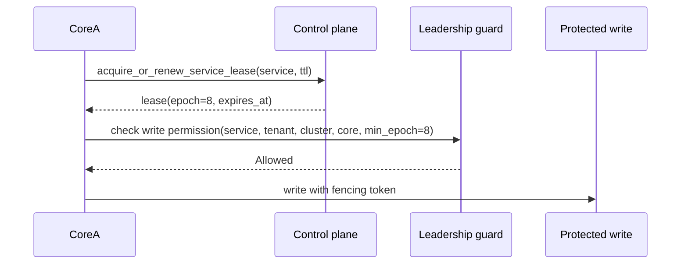

# Distributed Operation

Imagine two runtime cores after a network pause. One core still believes it is allowed to run a scheduled service. Another core has already renewed the lease and continued work. If both can write, the cluster corrupts its own state.

Distributed AppCore is built to make that situation explicit. The pieces are control plane, leases, discovery, Peer RPC, optional gateway mesh relay, and provider-selected coordination.

Private networking is not authentication. A node must still validate tenant, cluster, protocol, target core, nonce, expiry, payload hash, and credential binding.

## What problem does the control plane solve?

The control plane records runtime presence, heartbeats, peer discovery, and service-scoped leadership. The file control-plane provider is a crash-consistent reference implementation for a shared deployment directory.

Every file-control-plane operation:

1. takes an operating-system file lock;
2. reloads bounded validated state;
3. prunes stale registrations using the authoritative clock;
4. applies exactly one operation;
5. atomically persists the resulting state.

The durable state envelope has a format version and a maximum size. Unsupported versions fail with the same update-wall language used elsewhere: old state is not guessed into a new shape.

The control plane is not a business database. It answers runtime coordination questions: who is present, which peers are discoverable, and which core currently holds a service lease.

## Why is election not enough without fencing?

Leadership is scoped by service ID, not global runtime identity. A lease includes service, tenant, cluster, holder core, expiry, and epoch. The epoch is the fencing token.



A stale leader fails when:

- the lease expired;
- the holder core differs;
- tenant or cluster differs;
- the requested minimum epoch is newer than the held lease.

That is why AppCore documents "leader election" together with "fencing". Election chooses a holder. Fencing protects writes after leadership changes or delayed messages.

If a delayed old leader wakes up and attempts a protected write with an old epoch, the guard can reject it. This is the difference between "we elected someone" and "old work cannot still commit".

## Why are providers selected explicitly?

Deployment manifests select providers explicitly. The provider plan extracts storage, control plane, coordination store, secret provider, job provider, peer discovery, update provider, database provider, peer transport, command transport, and named adapters.

Provider factories are registered by role and provider ID. If the selected role/provider pair is unavailable, provider creation fails. There is no automatic fallback from remote to local, cluster to standalone, or secure to insecure.

## What does Peer RPC validate before dispatch?

Peer RPC envelopes bind:

- request ID;
- trace ID and optional trace context;
- protocol version;
- source core;
- target core;
- tenant;
- cluster;
- timestamp and expiry;
- nonce;
- capability;
- body hash;
- optional idempotency key.

Validation checks payload size, tenant, cluster, target core, protocol compatibility, time window, body hash, trace consistency, and nonce replay. The nonce store may be in-memory or file-backed. The file-backed store uses owner-private files, bounded JSON state, locks, and atomic replacement.

The peer token can also bind a request hash. That hash covers routing metadata and payload integrity so a bearer token cannot be replayed for a different peer request.

V2 rejections are typed and bounded. A fixed code determines phase and whether
a higher-level idempotent operation may retry; the peer cannot independently
assert retryability. Unknown or contradictory metadata fails conservatively.
V1 retains its string field, but the client recognizes only exact controlled
codes and never interprets substrings. Selecting V2 is an explicit coordinated
deployment decision; V1 peers are not upgraded or redirected.

## Why does the gateway exist?

The gateway exists for Cores that can make outbound connections but cannot expose stable inbound ports. It is a relay, not a business API.

Gateway activation is declarative. Selecting the owned adapter in the
Deployment Manifest makes the deployment executable parse the bounded configuration, add
and authorize `runtime.gateway` in the shared capability catalog, reuse Runtime
security, and register the instance as a critical Supervisor-managed service:

```toml
[adapters.gateway]
provider_id = "appcore-gateway"
settings = { bind_address = "127.0.0.1:8080", domain_suffix = "gateway.example.com", heartbeat_interval_ms = "30000", heartbeat_timeout_ms = "90000" }
secret_refs = {}
```

Only those four non-secret settings are accepted. Unknown settings, endpoints,
secret references, and authentication overrides fail closed. If the adapter is
absent, no Gateway listener or task is created. Invalid configuration or bind
failure aborts startup rather than leaving a partially active host.

Worker and client connection tokens are short-lived, single-use, and bound to a request hash. Worker hashes bind tenant, cluster, installation, core, and advertised capabilities. Client hashes bind tenant, cluster, and device. Gateway mesh requests validate that the outer relay metadata matches the inner Peer RPC envelope.


The gateway never interprets opaque business payloads. It routes by tenant/core/capability and enforces bounded message sizes, timeouts, queue limits, and credential checks.

The host uses a durable process-safe replay store. Standalone mode places it in
private Runtime storage; cluster mode requires absolute
`paths.gateway_replay` pointing to a writable file shared by every Gateway
instance. Active sockets expire within 60 seconds. Bounded shutdown
force-closes incomplete connections before joining all Gateway-owned work.

## Limitations

- The file control-plane provider is a reference implementation for a shared deployment directory, not a globally distributed consensus system.
- Service leases require clocks and TTLs to be configured conservatively for the deployment.
- Peer RPC authenticates and bounds runtime envelopes; it does not define business authorization rules.
- The gateway relays opaque peer traffic and cannot resolve application-level conflicts.
- Cluster Gateway operation fails closed without an explicit shared replay
  file; the Runtime does not silently fall back to process-local replay state.
- Provider selection is strict. A missing provider fails startup instead of falling back to a weaker local option.

Continue with [supervisor and lifecycle](/architecture/supervisor).

## Application transport migration

Application envelope/schema versions, Runtime sync wire versions and Peer RPC
transport versions are independent. Moving bytes through streaming V2 does not
upgrade a domain schema or change leader-to-follower semantics. Existing chunks
and streams already exist; migration needs explicit application adapters.

## Mapping and deployment contract

| Application boundary | Streaming boundary | Preserved responsibility |
| --- | --- | --- |
| V1 negotiation / status | Versioned application capability query | Advertise supported transport explicitly; absence means not eligible for V2 |
| `IngestChunkV1` | Verified open/chunk/commit stream carrying application payload | External adapter reconstructs/validates application bytes, identity, sequence and digest |
| `PullRequestV1` / `PullChunkV1` | Explicit command/query and bounded response pull frames | Preserve cursor, checkpoint and authorization semantics outside frame transport |
| Snapshot pages / application events | Bounded opaque payloads | Application validates schema and publishes only a complete verified result |

The external protocol package must own the actual mapping and golden fixtures.
Keep maintained application V1 endpoints available for old application clients
only in that external package. Do not teach Runtime V1 endpoints to infer V2,
parse removed envelopes or convert application formats. Removed Runtime inputs
still return `NO MORE SUPPORTED PLEASE UPDATE`.

## Staged migration

1. Inventory deployed envelope/schema versions, identities, scopes, byte limits,
   retry behavior and persisted outboxes/checkpoints. Record golden V1 fixtures
   in the application repository; never copy business schemas into Runtime.
2. Add an explicitly versioned application capability to the external adapter.
   Enable `PeerRpcStreamRegistry` on an existing owner-only spool directory and
   install it with `PeerRpcHttpHost::with_v2_stream_registry`. Set per-capability
   byte/deadline limits; verify tenant, cluster, origin and target before dispatch.
3. Keep maintained application V1 clients on their explicit existing path.
   Select V2 only after validated application capability negotiation or an
   explicit deployment setting. The default Runtime host remains V1-only.
   Canonical JSON V2 is separate from binary framing: binary needs host
   `with_v2_binary_codec` and client
   `with_stream_codec_v2(PeerRpcStreamCodecV2::Binary)` together.
4. Prove identical application payload/result and checkpoint behavior through
   each selected transport. Test timeout, cancellation, replay, duplicate
   command, corruption, oversize, isolation, peer loss and ambiguous commit.
   Never retry V2 frames automatically after an ambiguous transport failure;
   reconcile application receipts using the same idempotency key before retry.
5. Roll out receiver adapters first, then selected senders. Monitor safe error
   codes, admission saturation, spool cleanup and checkpoint lag. Keep rollout
   cohorts explicit; do not silently downgrade on authentication or media errors.
6. Roll back by stopping new V2 sends, draining/expiring sessions, reconciling
   committed command receipts and preserving outboxes/checkpoints. Resume the
   explicitly selected maintained application V1 adapter only if its schema and
   persisted state remain compatible. Incompatible persistence needs a reviewed
   version/migration/rollback plan; do not erase state or invent conversion.

## Acceptance evidence

Required application-owned evidence: old client/new receiver, new sender/new
receiver, explicitly selected old sender/old receiver, and controlled refusal
for unsupported pairs. Require byte-equivalent golden payloads, no duplicate
publication on idempotent replay, no permanent pending reservations on failure,
no partial snapshot publication, bounded resource use and restart recovery.
Runtime tests certify transport primitives, not an unimplemented external
mapping. No application adapter is supplied by this document.

## Nonce durability and typed diagnostics

Windows nonce publication syncs the file and replaces it with `MOVEFILE_WRITE_THROUGH`; it does not reopen the parent as a Unix directory. Unix retains parent sync. `PeerRpcDiagnosticV2::from_wire` preserves validated code, phase, retry and correlation plus a trusted peer identity and protocol-owned action. Unknown codes remain redacted and terminal. Expiry suggests checking deadline/clock but does not prove clock skew. A retry suggestion never authorizes replay of an ambiguously acknowledged command. This is an additive local projection; V1/V2 wire error fields are unchanged.

## Independent peer and queue progress

`OperationalProjectionV1` separately carries local health, Gateway reachability, persistence, delivery phase and at most 1,024 peer observations. Registration does not imply connection or health; discovery scope never claims a complete global roster. Pending batches and optional object counts have distinct semantics. Heartbeat/queue age must come from local monotonic elapsed time; wall-clock values are display timestamps only. `validate` rejects duplicate/oversized identities, future versions and checkpoints beyond observed head; `lag` returns unknown when evidence is missing. Authenticate/tenant-filter inputs before export. Pair this projection with validated `PeerRpcDiagnosticV2` for the last transport failure. It never restarts a service or supervises an OS process.

## Gateway routing evidence

`GatewayError::diagnostic_v1` exports a controlled category and bounded correlation without raw authentication/provider detail. Use `GatewayFailureDiagnosticV1::from_selection` before flattening `WorkerSelectionError` to preserve absent worker, unhealthy worker and capacity distinctions. Existing coarse `WorkerUnavailable` stays coarse; no cause is guessed from text. Retry hints require safe idempotent operations and do not authorize ambiguous command replay.

## Explicit operation-token binding V2 on V1 envelopes

Unpublished additive authentication profile: select `with_v1_operation_binding_v2` on both `PeerRpcClient` and `PeerRpcHttpHost`. `operation_signing_hash_v2` binds an explicit V2 domain, `query`/`command` and the complete existing V1 envelope digest. The V1 envelope schema, protocol number and routes are unchanged; the token-binding contract is explicitly V2. Neither side negotiates, infers nor accepts an alternative digest. A profile mismatch fails authentication. Health/manifest and streaming V2 retain their existing authentication.

The published default envelope-only V1 profile remains available for contract stability and does not cryptographically bind the route class. Select the operation-bound profile or streaming V2 when that threat boundary matters; dispatcher capability and invocation-mode authorization is always required. Upgrade both endpoints atomically or move traffic to a separately configured host. Drain ambiguous command attempts first. Rollback requires explicit coordinated restoration of both profile selections; never retry an ambiguously acknowledged command with a fresh key. This source change does not certify or publish an installation migration.
