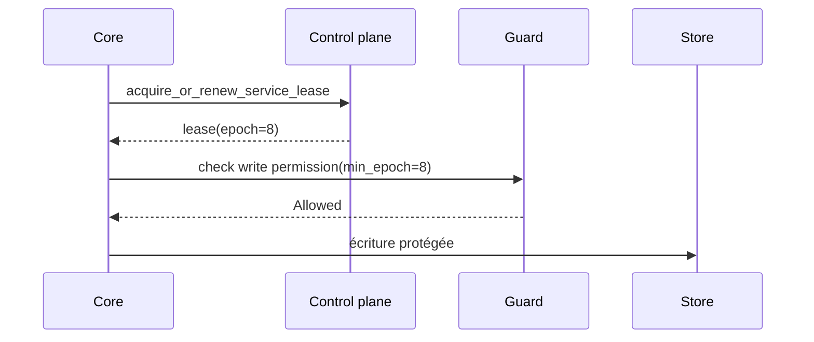

# Fonctionnement distribué

Imaginez un core qui revient après une pause réseau et croit encore être leader. Un autre core a déjà renouvelé le lease. Le problème n'est pas seulement l'élection ; il faut empêcher l'ancien leader de commit.

Le distribué AppCore combine control plane, leases, discovery, Peer RPC, gateway mesh relay et providers de coordination explicites.

Le réseau privé n'est pas une authentification. Chaque node valide encore
tenant, cluster, protocole, core cible, nonce, expiry, payload hash et liaison
du credential.

## Quel problème le control plane résout-il ?

Le file control plane prend un lock, recharge un état validé et borné, supprime les enregistrements expirés, applique une opération et persiste atomiquement.

Chaque opération :

1. prend un file lock du système d'exploitation ;
2. recharge un état validé et borné ;
3. supprime les enregistrements expirés selon le clock autoritatif ;
4. applique exactement une opération ;
5. persiste atomiquement l'état résultant.

Le control plane enregistre presence, heartbeat, peer discovery et leadership
par service. Son envelope durable possède format version et taille maximale ;
une version incompatible échoue à l'update wall au lieu d'être devinée. Il
répond qui est présent et qui détient un lease, mais ce n'est pas une database
métier.

Il enregistre présence, heartbeats, discovery et leadership par service. Ce
n'est pas une base métier. Son état durable possède une version de format et
une taille maximale ; une version incompatible échoue explicitement.

## Pourquoi l'élection ne suffit-elle pas sans fencing ?

Leadership est scoped par `service_id`. Un lease contient service, tenant, cluster, holder core, expiry et epoch. L'epoch est le fencing token.



Un ancien leader échoue lorsque :

- le lease a expiré ;
- le holder core diffère ;
- tenant ou cluster diffère ;
- l'epoch minimum demandé est plus récent que le lease courant.

L'élection choisit un holder ; le fencing empêche l'ancien travail de commit
après un changement.

Un ancien leader qui se réveille avec un epoch périmé voit son commit rejeté
par le guard. Cette protection distingue une élection observée de la garantie
que l'ancien travail ne peut plus agir.

## Pourquoi les providers sont-ils sélectionnés explicitement ?

Le Deployment Manifest sélectionne storage, control plane, coordination store,
secret provider, jobs, discovery, update, database et transports. Les factories
sont enregistrées par role et provider ID. Une paire absente échoue ; aucun
fallback de distant vers local, cluster vers standalone ou sûr vers non sûr.

## Que valide Peer RPC avant le dispatch ?

L'envelope lie :

- request ID ;
- trace ID et trace context facultatif ;
- protocol version ;
- source core ;
- target core ;
- tenant ;
- cluster ;
- timestamp et expiry ;
- nonce ;
- capability ;
- body hash ;
- idempotency key facultative.

Peer RPC valide request ID, trace, protocole, source/target core, tenant,
cluster, timestamp, expiry, nonce, capability, body hash et idempotency key
optionnelle. Le nonce store peut être en mémoire ou sur fichier privé, borné,
verrouillé et remplacé atomiquement.

La validation borne aussi le payload et contrôle protocol, fenêtre temporelle,
cohérence du trace et replay du nonce. Le token peer peut se lier au hash
complet de la request afin qu'un bearer token ne serve pas pour un autre routing
ou body.

Les rejets V2 sont typés et bornés. Un code fixe détermine phase et si une
opération idempotente de niveau supérieur peut retenter; le peer ne déclare pas
retryability indépendamment. Des métadonnées inconnues ou contradictoires
échouent de façon conservatrice. V1 conserve le champ string, mais le client ne
reconnaît que les codes contrôlés exacts et n'interprète jamais de sous-chaîne.
La sélection V2 est une décision de deployment explicite et coordonnée; les
peers V1 ne sont ni mis à niveau ni redirigés.

## Pourquoi le Gateway existe-t-il ?

Gateway existe pour les cores sans port entrant stable. Il relaie et route,
mais n'interprète jamais le payload métier opaque.

L'activation Gateway est déclarative. Quand le Deployment Manifest sélectionne
l'adapter, l'exécutable de déploiement valide la configuration, ajoute et autorise
`runtime.gateway` dans le catalogue partagé, réutilise la sécurité Runtime et
enregistre le Gateway comme service critique du Supervisor :

```toml
[adapters.gateway]
provider_id = "appcore-gateway"
settings = { bind_address = "127.0.0.1:8080", domain_suffix = "gateway.example.com", heartbeat_interval_ms = "30000", heartbeat_timeout_ms = "90000" }
secret_refs = {}
```

Seuls ces quatre settings non secrets sont acceptés. Settings inconnus,
endpoints, références de secret et overrides d'authentification échouent
fermés. Sans l'adapter, aucun listener ni task Gateway n'est créé ; une
configuration ou un bind invalide arrête le startup.


Les tokens worker et client sont courts, à usage unique et liés à un hash. Le
hash worker couvre tenant, cluster, installation, core et capabilities ; celui
du client couvre tenant, cluster et device. Le relay vérifie la concordance de
la metadata externe avec l'envelope Peer RPC puis borne messages, timeouts et
files sans interpréter le payload opaque.

Le host utilise un replay store durable et sûr entre processus. Standalone le
place dans le storage privé ; cluster exige un `paths.gateway_replay` absolu
vers un fichier inscriptible partagé par toutes les instances. Les sockets
expirent en 60 secondes maximum et le shutdown borné ferme les connexions
incomplètes.

## Limitations

- Le file control plane est une référence pour répertoire partagé, pas un consensus global.
- Les leases exigent TTLs et horloges configurés prudemment.
- Peer RPC authentifie l'enveloppe runtime ; l'autorisation métier appartient à l'application.
- Gateway relaie des payloads opaques et ne résout pas les conflits.
- Gateway en cluster échoue fermé sans replay file partagé explicite.
- Provider absent échoue le startup ; AppCore ne bascule pas vers une option plus faible.

Suivant : [supervisor](/fr/architecture/supervisor).

## Migration du transport applicatif

Versions d'enveloppe/schema applicatif, wire sync et transport Peer RPC sont
indépendantes. Streaming V2 ne modifie ni schema métier ni réplication
leader-follower. Chunks/streams existent déjà ; migrer exige des adaptateurs
applicatifs externes explicites.

## Mapping et contrat de deployment

| Frontière applicative | Frontière streaming | Responsabilité conservée |
| --- | --- | --- |
| Négociation / status V1 | Query de capability applicative versionnée | Déclarer transport supporté ; absence signifie non éligible V2 |
| `IngestChunkV1` | Stream open/chunk/commit vérifié avec payload applicatif | Adaptateur externe reconstruit/valide octets, identité, séquence et digest |
| `PullRequestV1` / `PullChunkV1` | Command/query explicite et réponse pull bornée | Conserver curseur, checkpoint et autorisation hors frames |
| Pages snapshot / événements | Payloads opaques bornés | Application valide schema et publie seulement un résultat complet vérifié |

Le package de protocole externe doit contenir le mapping et les fixtures golden. Conserver
les endpoints applicatifs V1 pour anciens clients seulement dans ce package.
Runtime V1 n'infère pas V2, ne lit pas d'enveloppes supprimées et ne convertit
pas les formats applicatifs. Les entrées Runtime supprimées retournent toujours
`NO MORE SUPPORTED PLEASE UPDATE`.

## Migration par étapes

1. Inventorier versions installées, identités, scopes, limites, retries et
   outboxes/checkpoints persistés. Garder fixtures V1 dans le dépôt applicatif ;
   aucun schema métier dans Runtime.
2. Ajouter une capability versionnée explicite à l'adaptateur externe.
   Configurer `PeerRpcStreamRegistry` dans un spool existant owner-only et
   installer via `PeerRpcHttpHost::with_v2_stream_registry`. Définir budgets par
   capability ; valider tenant, cluster, origine et cible avant dispatch.
3. Les clients applicatifs V1 gardent leur chemin explicite actuel. Sélectionner
   V2 après négociation validée ou setting deployment explicite. L'hôte Runtime
   par défaut reste V1. JSON canonique V2 est distinct du binaire : ce dernier
   exige hôte `with_v2_binary_codec` et client
   `with_stream_codec_v2(PeerRpcStreamCodecV2::Binary)` ensemble.
4. Prouver payload/résultat et checkpoints équivalents par transport. Tester
   timeout, annulation, replay, duplication, corruption, oversize, isolation,
   perte de pair et commit ambigu. Ne pas répéter automatiquement les frames
   après panne ambiguë ; réconcilier receipts avec la même clé d'idempotence.
5. Déployer les receivers d'abord, puis senders sélectionnés. Observer codes
   sûrs, saturation, nettoyage du spool et retard checkpoint. Cohortes explicites ;
   aucun downgrade silencieux après erreur d'authentification ou media type.
6. Rollback : arrêter nouveaux sends V2, drainer/expirer sessions, réconcilier
   receipts et préserver outboxes/checkpoints. Reprendre l'adaptateur externe V1
   explicitement avec schema/état compatibles. Persistance incompatible exige
   plan version/migration/rollback revu ; ni effacement ni conversion inférée.

## Preuves de conclusion

Preuves applicatives : ancien client/nouveau receiver, nouveau sender/nouveau
receiver, paire ancienne choisie explicitement et refus contrôlé des paires non
supportées. Exiger payloads golden équivalents, replay sans publication double,
aucune réservation pending permanente après erreur, aucun snapshot partiel,
ressources bornées et recovery après restart. Les tests Runtime certifient les
primitives, pas le mapping externe. Ce document ne fournit pas l'adaptateur.

## Durabilité du nonce et diagnostic typé

Sous Windows, la publication du nonce synchronise le fichier puis utilise `MOVEFILE_WRITE_THROUGH` ; elle ne rouvre pas le parent comme répertoire Unix. Unix conserve le sync du parent. `PeerRpcDiagnosticV2::from_wire` conserve code, phase, retry et corrélation validés, une identité de peer fiable et une action définie par le protocole. Les codes inconnus restent expurgés et terminaux. Une expiration suggère de vérifier deadline/horloge sans prouver une dérive. Une suggestion de retry ne permet jamais le replay d’un command dont l’ack est ambigu. Projection locale additive ; les champs wire V1/V2 restent inchangés.

## Progrès indépendant des peers et de la file

`OperationalProjectionV1` expose séparément santé locale, accès Gateway, persistance, phase d’envoi et au plus 1 024 peers. Enregistrement n’implique ni connexion ni santé ; la portée de découverte ne promet pas de roster global complet. Batches pending et nombre optionnel d’objets sont distincts. L’âge heartbeat/file vient du temps monotone local écoulé ; l’horloge murale sert uniquement aux timestamps d’affichage. `validate` refuse identités dupliquées/excessives, versions futures et checkpoints au-delà du head observé ; `lag` reste inconnu sans preuves. Authentifiez et filtrez les inputs par tenant avant export. Associez `PeerRpcDiagnosticV2` validé pour le dernier échec de transport. Aucun redémarrage de service ni supervision de processus OS.

## Preuves de routing Gateway

`GatewayError::diagnostic_v1` exporte catégorie contrôlée et corrélation bornée sans détail brut d’authentification/provider. Utilisez `GatewayFailureDiagnosticV1::from_selection` avant de réduire `WorkerSelectionError` en texte pour conserver worker absent, non sain et sans capacité. `WorkerUnavailable` général reste général ; aucune cause n’est déduite du texte. Retry exige des opérations idempotentes sûres et n’autorise aucun replay de command ambigu.

## Liaison explicite de l’opération au token V2 pour les envelopes V1

Profil d’authentification additif non publié : sélectionnez `with_v1_operation_binding_v2` sur `PeerRpcClient` et `PeerRpcHttpHost`. `operation_signing_hash_v2` lie un domaine V2 explicite, `query`/`command` et le digest complet de l’envelope V1 existante. Schéma, numéro de protocole et routes V1 restent inchangés ; le contrat de liaison du token est explicitement V2. Aucun côté ne négocie, ne déduit ni n’accepte un digest alternatif. Des profils différents échouent à l’authentification. Health/manifest et streaming V2 conservent leur authentification.

Le profil V1 publié par défaut conserve seulement l’envelope pour la stabilité contractuelle et ne lie pas cryptographiquement la classe de route. Sélectionnez le profil avec opération ou streaming V2 lorsque cette frontière compte ; le dispatcher doit toujours autoriser capability et mode d’invocation. Mettez à jour les deux endpoints atomiquement ou déplacez le trafic vers un host configuré séparément. Drainez d’abord les commands ambigus. Le rollback restaure explicitement les sélections des deux côtés ; ne répétez pas un command au reçu incertain avec une nouvelle clé. Cette modification ne certifie ni ne publie une migration d’installation.
