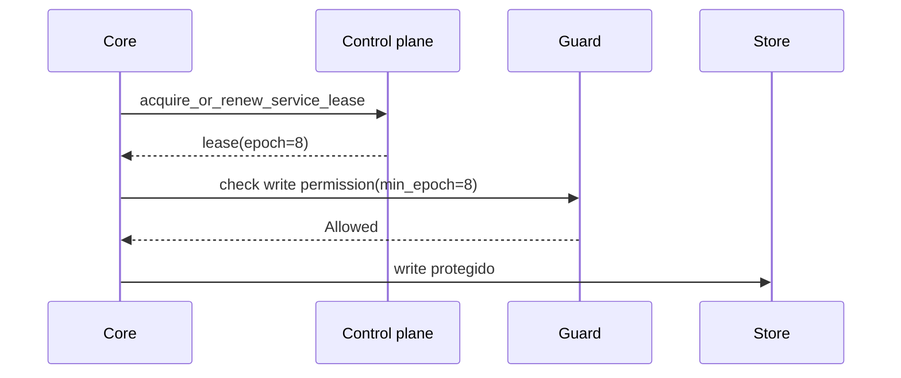

# Operação distribuída

Imagine um core que perdeu rede e acorda atrasado ainda acreditando ser líder. Outro core já renovou o lease. O problema não é ele "achar" que é líder; é impedir que ele ainda consiga gravar.

Distribuição no AppCore combina control plane, leases, discovery, Peer RPC, gateway mesh relay e providers de coordenação explícitos.

Rede privada não é autenticação. Um node ainda valida tenant, cluster,
protocol, target core, nonce, expiry, payload hash e vínculo da credencial.

## Control plane

O file control plane toma lock, recarrega estado validado e limitado, remove registros expirados, aplica uma operação e persiste atomicamente. O estado tem versão de formato e limite de 16 MiB.

Cada operação:

1. toma um file lock do sistema operacional;
2. recarrega estado validado e limitado;
3. remove registros expirados usando o clock autoritativo;
4. aplica exatamente uma operação;
5. persiste atomicamente o estado resultante.

O control plane registra presence, heartbeat, peer discovery e leadership por
serviço. Seu envelope durável possui format version e tamanho máximo; versões
incompatíveis falham na update wall em vez de serem convertidas por tentativa.
Ele responde quem está presente e quem possui um lease, mas não é database de
negócio.

## Leases e fencing

Leadership é por `service_id`. O lease carrega service, tenant, cluster, holder core, expiry e epoch. O epoch é o fencing token.



Um líder antigo falha quando:

- o lease expirou;
- o holder core é diferente;
- tenant ou cluster é diferente;
- o epoch mínimo solicitado é mais novo que o lease atual.

Election escolhe o holder; fencing protege writes após troca de liderança ou
mensagem atrasada. Se um líder antigo acorda com um epoch anterior, o guard
rejeita o commit. Apenas acreditar que uma eleição ocorreu não oferece essa
garantia.

## Por que providers são selecionados explicitamente?

O Deployment Manifest seleciona storage, control plane, coordination store,
secret provider, jobs, discovery, update, database e transports. Factories são
registradas por role e provider ID. Se o par escolhido não existir, a criação
falha; não há fallback de remoto para local, cluster para standalone ou seguro
para inseguro.

## Peer RPC

O envelope vincula:

- request ID;
- trace ID e trace context opcional;
- protocol version;
- source core;
- target core;
- tenant;
- cluster;
- timestamp e expiry;
- nonce;
- capability;
- body hash;
- idempotency key opcional.

O envelope valida request ID, trace, protocolo, source/target core, tenant, cluster, timestamp, expiry, nonce, capability, body hash e idempotency key opcional. Nonces podem ser armazenados em memória ou arquivo privado com lock e atomic write.

A validação limita payload e confere protocol, janela de tempo, consistência do
trace e replay do nonce. O store em arquivo usa JSON limitado, permissões
privadas, locks e substituição atômica. O token peer pode se vincular ao hash
completo do request, impedindo reutilização para outro routing ou body.

Rejeições V2 são tipadas e limitadas. Um code fixo determina phase e se uma
operação idempotente de nível superior pode fazer retry; o peer não declara
retryability de forma independente. Metadata desconhecida ou contraditória
falha conservadoramente. V1 mantém o campo string, mas o client reconhece
somente codes controlados exatos e nunca interpreta substrings. Selecionar V2 é
uma decisão coordenada e explícita de deployment; peers V1 não são atualizados
ou redirecionados.

## Gateway

Gateway existe para cores com conexão outbound mas sem porta inbound estável. Tokens de conexão são curtos, single-use e bound ao hash da conexão. Mesh relay valida que metadata externa combina com o envelope Peer RPC interno. O gateway nunca interpreta payload de negócio.

A ativação é declarativa. Ao selecionar o adapter no Deployment Manifest, o
executável de deployment valida a configuração, inclui e autoriza `runtime.gateway` no
catálogo compartilhado, reutiliza a segurança do Runtime e registra o Gateway
como serviço crítico do Supervisor:

```toml
[adapters.gateway]
provider_id = "appcore-gateway"
settings = { bind_address = "127.0.0.1:8080", domain_suffix = "gateway.example.com", heartbeat_interval_ms = "30000", heartbeat_timeout_ms = "90000" }
secret_refs = {}
```

Somente essas quatro settings sem segredo são aceitas. Settings desconhecidas,
endpoints, referências de segredo e overrides de autenticação falham fechados.
Sem o adapter não existe listener nem task de Gateway; configuração ou bind
inválido aborta o startup.


Tokens de worker e client têm vida curta, uso único e hash vinculado. O hash do
worker inclui tenant, cluster, installation, core e capabilities; o do client
inclui tenant, cluster e device. O relay confirma que a metadata externa combina
com o envelope Peer RPC e limita mensagens, timeouts e filas sem interpretar o
payload opaco.

O host usa replay store durável e seguro entre processos. Standalone o mantém
no storage privado; cluster exige `paths.gateway_replay` absoluto apontando
para um arquivo gravável e compartilhado por todas as instâncias. Sockets
expiram em até 60 segundos e o shutdown limitado fecha conexões incompletas.

## Limitations

- O file control plane é referência para diretório compartilhado, não consenso global.
- Leases exigem TTLs e relógios configurados de forma conservadora.
- Peer RPC autentica envelope de runtime; autorização de domínio pertence à aplicação.
- Gateway relaya payload opaco e não resolve conflitos.
- Gateway em cluster falha fechado sem replay file compartilhado explícito.
- Provider ausente falha startup; AppCore não cai para opção mais fraca.

Próximo: [supervisor](/pt/architecture/supervisor).

## Migração do transporte da aplicação

Versões de envelope/schema da aplicação, wire do sync e transporte Peer RPC são
independentes. Streaming V2 não atualiza schema de domínio nem muda semântica
líder-seguidor. Chunks/streams já existem; migração exige adaptadores externos
explícitos da aplicação.

## Mapeamento e contrato de deployment

| Fronteira da aplicação | Fronteira streaming | Responsabilidade preservada |
| --- | --- | --- |
| Negociação / status V1 | Query de capability versionada da aplicação | Declarar transporte suportado; ausência significa não elegível para V2 |
| `IngestChunkV1` | Stream open/chunk/commit verificado com payload da aplicação | Adaptador externo reconstrói/valida bytes, identidade, sequência e digest |
| `PullRequestV1` / `PullChunkV1` | Command/query explícito e resposta pull limitada | Preservar cursor, checkpoint e autorização fora dos frames |
| Páginas de snapshot / eventos | Payloads opacos limitados | Aplicação valida schema e publica somente resultado completo verificado |

O pacote externo de protocolo deve conter o mapeamento e fixtures golden. Manter
endpoints V1 da aplicação para clientes antigos somente nesse pacote externo.
Runtime V1 não infere V2, não lê envelopes removidos nem converte formatos da
aplicação. Entradas removidas do Runtime continuam retornando
`NO MORE SUPPORTED PLEASE UPDATE`.

## Migração em etapas

1. Inventariar versões instaladas, identidades, scopes, limites, retries e
   outboxes/checkpoints persistidos. Registrar fixtures V1 no repositório da
   aplicação; schemas de negócio não entram no Runtime.
2. Adicionar capability versionada explícita ao adaptador externo. Configurar
   `PeerRpcStreamRegistry` em spool existente owner-only e instalar com
   `PeerRpcHttpHost::with_v2_stream_registry`. Definir limites por capability e
   validar tenant, cluster, origem e destino antes do dispatch.
3. Clientes V1 da aplicação mantêm caminho explícito atual. Selecionar V2 apenas
   após negociação validada ou setting explícito de deployment. Host Runtime
   padrão permanece V1. JSON canônico V2 é distinto do binário: este exige host
   `with_v2_binary_codec` e client
   `with_stream_codec_v2(PeerRpcStreamCodecV2::Binary)` juntos.
4. Provar payload/resultado e checkpoints equivalentes por transporte. Testar
   timeout, cancelamento, replay, duplicação, corrupção, oversize, isolamento,
   perda de peer e commit ambíguo. Não repetir frames automaticamente após falha
   ambígua; reconciliar receipts da aplicação com a mesma chave de idempotência.
5. Atualizar receivers primeiro, depois senders selecionados. Monitorar códigos
   seguros, saturação, limpeza do spool e atraso de checkpoint. Cohorts explícitos;
   não fazer downgrade silencioso após erro de autenticação ou media type.
6. Rollback: parar novos sends V2, drenar/expirar sessões, reconciliar receipts
   e preservar outboxes/checkpoints. Retomar adaptador V1 externo explicitamente
   somente com schema/estado compatíveis. Persistência incompatível exige plano
   revisado de versão/migração/rollback; não apagar nem converter por inferência.

## Evidência de conclusão

Evidência da aplicação: cliente antigo/receiver novo, sender novo/receiver novo,
par antigo selecionado explicitamente e recusa controlada dos pares não
suportados. Exigir payloads golden equivalentes, replay sem publicação duplicada,
falhas sem reserva pending permanente, snapshots sem publicação parcial,
recursos limitados e recovery após restart. Testes do Runtime certificam
primitivas, não o mapeamento externo. Este documento não fornece o adaptador.

## Durabilidade do nonce e diagnóstico tipado

A publicação do nonce no Windows sincroniza o ficheiro e substitui com `MOVEFILE_WRITE_THROUGH`; não reabre o parent como diretório Unix. Unix conserva o sync do parent. `PeerRpcDiagnosticV2::from_wire` conserva código, fase, retry e correlação validados, identidade confiável do peer e ação definida pelo protocolo. Códigos desconhecidos continuam redigidos e terminais. Expiração sugere verificar deadline/relógio, sem provar desvio do relógio. Uma sugestão de retry não autoriza replay de command com ack ambíguo. É uma projeção local aditiva; os campos wire V1/V2 permanecem iguais.

## Progresso independente de peers e fila

`OperationalProjectionV1` transporta separadamente saúde local, alcance Gateway, persistência, fase de envio e até 1 024 peers. Registo não implica conexão ou saúde; o escopo de descoberta não promete roster global completo. Batches pendentes e contagem opcional de objetos são distintos. Idade de heartbeat/fila vem de tempo decorrido monotónico local; relógio de parede serve apenas para timestamps de apresentação. `validate` recusa IDs duplicados/excessivos, versões futuras e checkpoints acima do head observado; `lag` é desconhecido sem evidência. Autentique e filtre inputs por tenant antes de exportar. Associe `PeerRpcDiagnosticV2` validado para a última falha de transporte. Não reinicia serviços nem supervisiona processos do SO.

## Evidência de routing Gateway

`GatewayError::diagnostic_v1` exporta categoria controlada e correlação limitada sem detalhe bruto de autenticação/provider. Use `GatewayFailureDiagnosticV1::from_selection` antes de reduzir `WorkerSelectionError` a texto para conservar worker ausente, sem saúde e sem capacidade. `WorkerUnavailable` genérico continua genérico; não se infere a causa pelo texto. Retry exige operações idempotentes seguras e não autoriza replay de command ambíguo.

## Vinculação explícita da operação no token V2 para envelopes V1

Perfil de autenticação aditivo ainda não publicado: selecione `with_v1_operation_binding_v2` tanto em `PeerRpcClient` como em `PeerRpcHttpHost`. `operation_signing_hash_v2` vincula domínio V2 explícito, `query`/`command` e digest completo do envelope V1 existente. Schema, número de protocolo e rotas V1 não mudam; o contrato de vinculação do token é explicitamente V2. Nenhum lado negoceia, deduz ou aceita digest alternativo. Perfis diferentes falham na autenticação. Health/manifest e streaming V2 mantêm a autenticação existente.

O perfil V1 publicado por omissão mantém apenas o envelope para estabilidade contratual e não vincula criptograficamente a classe da rota. Selecione o perfil com operação ou streaming V2 quando essa fronteira importar; o dispatcher deve sempre autorizar capability e modo de invocação. Atualize ambos os endpoints atomicamente ou transfira tráfego para um host configurado separadamente. Drene tentativas de commands ambíguas primeiro. O rollback exige restaurar explicitamente a seleção de ambos os lados; não repita um command com ACK incerto usando chave nova. Esta alteração não certifica nem publica uma migração da instalação.
